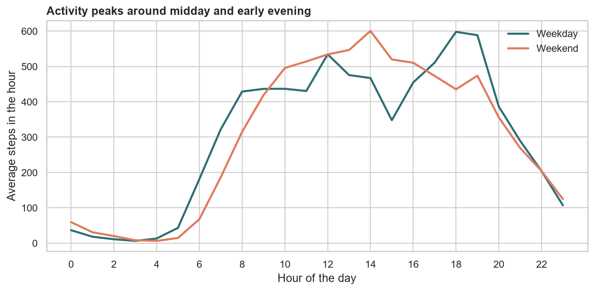
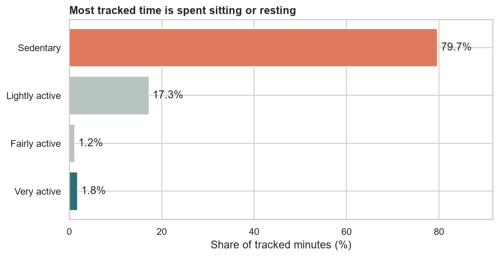

# Bellabeat Case Study: How Can a Wellness Company Play It Smart?

Google Data Analytics Capstone, Case Study 2. Built with Python (pandas, seaborn, matplotlib) and SQL (SQLite).

## Business question

Bellabeat makes health focused smart products for women. The cofounder wants to know how people use smart fitness devices so the marketing team can find new growth opportunities. This project analyzes Fitbit usage data and turns the trends into marketing recommendations for one Bellabeat product, the Time wellness watch.

1. What are some trends in smart device usage?
2. How could these trends apply to Bellabeat customers?
3. How could these trends help influence Bellabeat marketing strategy?

## Data

[FitBit Fitness Tracker Data](https://www.kaggle.com/datasets/arashnic/fitbit) (Kaggle, CC0 public domain). Personal tracker data from about 30 Fitbit users, collected from 03.12.2016 to 05.12.2016. The raw CSV files are not included in this repository because of their size. Download the dataset from Kaggle and place the two `Fitabase Data` folders next to the notebook to run it.

Files used: daily activity, hourly steps, daily sleep and weight log.

Limitations: a small sample, data from 2016, no gender or age information, and users who chose to share their data.

## Process

* **Prepare:** reviewed how the files are organized and checked the data against the ROCCC framework.
* **Process:** converted IDs and dates, combined the two collection periods, removed duplicates, dropped an almost empty column and excluded days where the tracker was probably not worn (zero steps).
* **Analyze:** SQL and pandas for feature usage, user groups by average daily steps, weekday and hourly patterns, and sleep.
* **Share:** eight charts, saved in the `visuals` folder.
* **Act:** product choice and three recommendations.

## Key findings

* Most tracked time is sedentary or lightly active, so the device is worn for ordinary daily life and not only for workouts.
* Movement follows a clear daily rhythm, with peaks around midday and early evening.
* Steps and calories burned move together strongly, but a large part of the day stays sedentary.
* Fewer users track sleep than activity, and many nights are shorter than seven hours.
* Manual features like weight logging are rarely used.

## Recommendations for the Bellabeat Time watch

1. Make the watch an all day companion, with nudges timed to the daily activity rhythm.
2. Make sleep a headline feature of the app and the membership.
3. Reduce manual effort and reward consistent wear with streaks and weekly summaries.

## How to run

1. Install Python 3 and the packages: `pip install pandas numpy matplotlib seaborn jupyter`
2. Download the dataset from Kaggle and put the two `Fitabase Data` folders in the same folder as the notebook.
3. Open `bellabeat_case_study.ipynb` and run all cells. Charts are saved to `visuals`.
